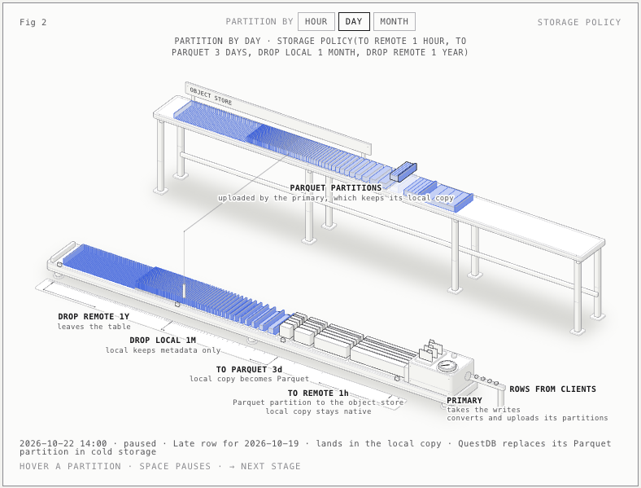
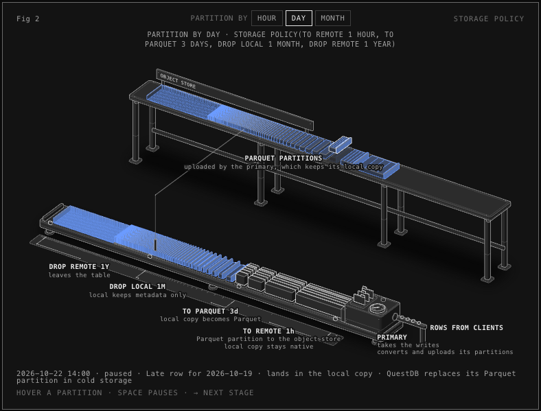
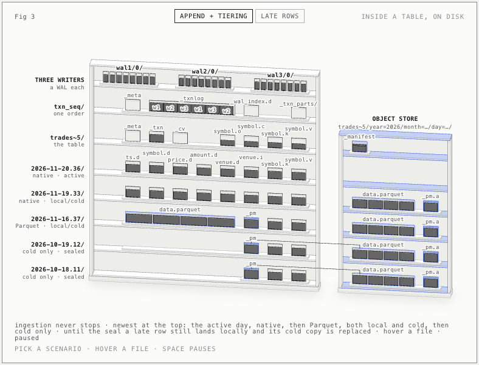
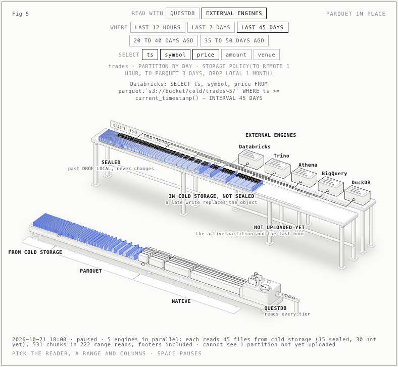
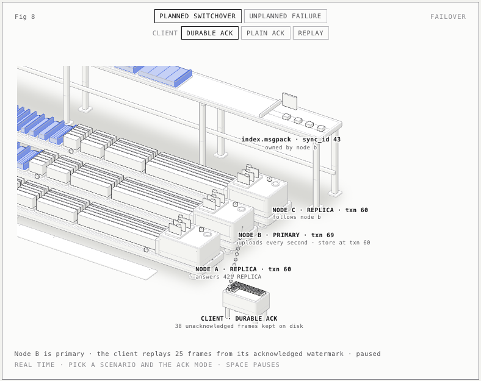
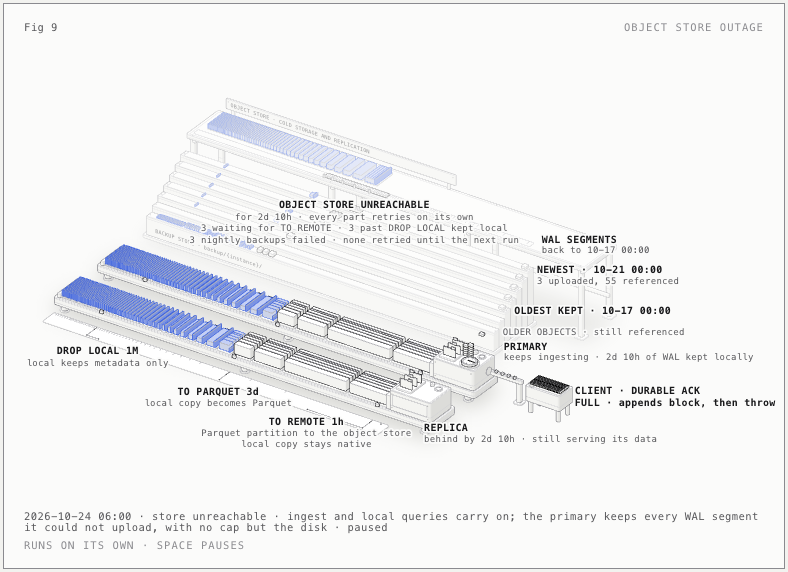
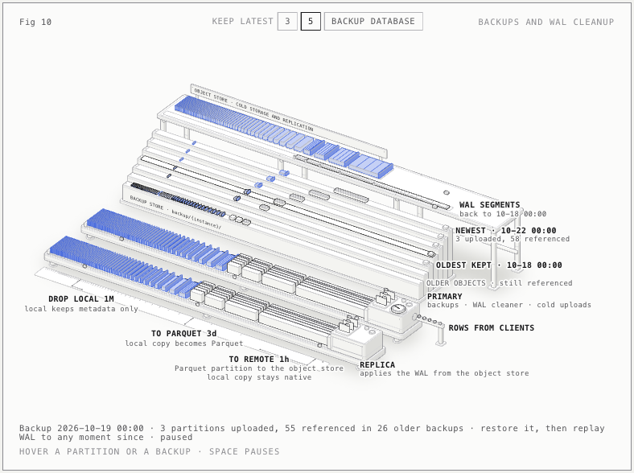
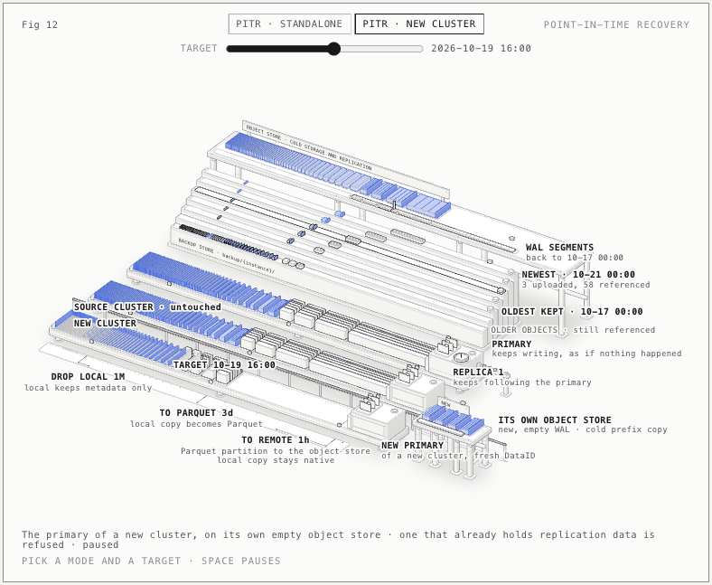

# Storage in QuestDB Enterprise

A series of live, interactive figures that explain where QuestDB Enterprise keeps data and how it moves: the files on disk for a native and a Parquet table, the storage policy that tiers partitions to Parquet and cold storage, queries across tiers, other engines reading cold storage in place, replication through the object store, failover, an object store outage, backups and WAL cleanup, and rebuilding an instance from them.

Every figure is a small working machine rather than a diagram. Each one runs from a model of the real behaviour, so every number it shows, every timing and every stage boundary comes from the same code that moves its parts. Defaults and behaviours were checked against the Enterprise source, not only the docs.

**See it live:** [light](https://javier.github.io/questdb-enterprise-storage-anatomy/) · [dark](https://javier.github.io/questdb-enterprise-storage-anatomy/index-dark.html)



## The figures

| Fig | Folder | What it shows |
| --- | --- | --- |
| 1 | `fig0-files` | The files on one instance's disk for two tables side by side: one native by default, which TO PARQUET converts as it ages, and one created FORMAT PARQUET, Parquet from its first row; parallel writers, the sequencer, apply, and late rows into either form |
| 2 | `fig1-partitions` | The storage policy on one instance: TO REMOTE, TO PARQUET, DROP LOCAL and DROP REMOTE by partition age, and what a late write does before and after the seal |
| 3 | `figA-internals` | The same files under the storage policy, with the object store beside them: one partition of each age (native, Parquet, and only `_pm` and the index after DROP LOCAL) level with its copy in cold storage, and late rows before and after the seal |
| 4 | `fig2-queries` | One query across tiers: native, local Parquet, and range reads from cold storage, as the data ages |
| 5 | `fig3-external` | Parquet in place: Databricks, Trino, Athena, BigQuery and DuckDB reading cold storage directly, and what only QuestDB can see |
| 6 | `fig4-replication` | Replication through the object store: WAL segments up from the primary, down to each replica |
| 7 | `fig5-cluster-policy` | The storage policy across a cluster: one instance uploads for all, the DROP LOCAL seal travels through the WAL, and the cold storage manager role moving or dying |
| 8 | `fig6-failover` | Planned switchover and unplanned failure, with a store-and-forward client and durable or plain ACK |
| 9 | `fig7-outage` | Three days without the object store: what piles up, what waits, what fails, and the catch-up |
| 10 | `fig8-backups` | Incremental backups by partition, retention, and the WAL cleaner trimming to the oldest kept backup |
| 11 | `fig9-replica` | A new replica restored from a backup, then catching up from the WAL |
| 12 | `fig10-pitr` | Point-in-time recovery: standalone or as a new cluster on its own object store |

The folder names keep the order the figures were first made in; the table gives their numbers today.

All of them, in order, are on one page: `series/index.html` (dark) and `series/index-light.html` (light). On that page every figure has a PAUSE / RESUME button under its number, to hold it at any moment, and RESTART beside it to run it again from the start; Space on a focused figure pauses too.

Every figure comes in both themes. Fig 2 at the same moment in each:

| Light | Dark |
| --- | --- |
|  |  |














## Building

The pages are plain HTML with the figure inlined; nothing needs a server. To rebuild everything after a change (tested with Node 22):

```sh
node build-all.mjs
```

That runs every figure's build in both themes, then the series pages. Each figure's `build.mjs` writes:

- `<name>.html` and `<name>-light.html`, a standalone page for the figure
- `<name>-dark.svg` and `<name>-light.svg`, a still of it
- `fragment-dark.json` and `fragment-light.json`, its plate and live script, which `series/build.mjs` stitches into the series pages
- `react/<Component>/`, the same figure as modules for a React site: the plate markup in `plate.generated.mjs` and the live code, with the shared modules copied beside it

Figs 11 and 12 share one model, drawing and live module in `recover/`, built with `node recover/build.mjs --fig replica` or `--fig pitr`.

## How it is put together

- `kit/` is the isometric drawing kit the figures are built with (`iso-kit.mjs`, `lathe.mjs`, `iso.css`), vendored from the anatomy figure kit under its MIT licence, which sits beside it. `inline-kit.mjs` returns it as source for the pages.
- `fig1-partitions/` (Fig 2) holds the pieces most later figures reuse: the storage policy model (`model.mjs`), the parts (`parts.mjs`), the moving scene (`scene.mjs`) and the benches and decks (`stage.mjs`).
- Each figure keeps its own model as a small pure module (`query.mjs`, `external.mjs`, `repl.mjs`, `fail.mjs`, `outage.mjs`, `backup.mjs`, `restore.mjs`, `files.mjs`), with a comment at the top that lists the behaviour it encodes and where it was checked.
- Everything a figure draws is a pure function of time, so pausing, skipping and the idle tours replay exactly.

Each figure's build also leaves its live code available for checks: the page's `.iso-stage` element has a `pick` or `seek` method that jumps to a moment and pauses there.
